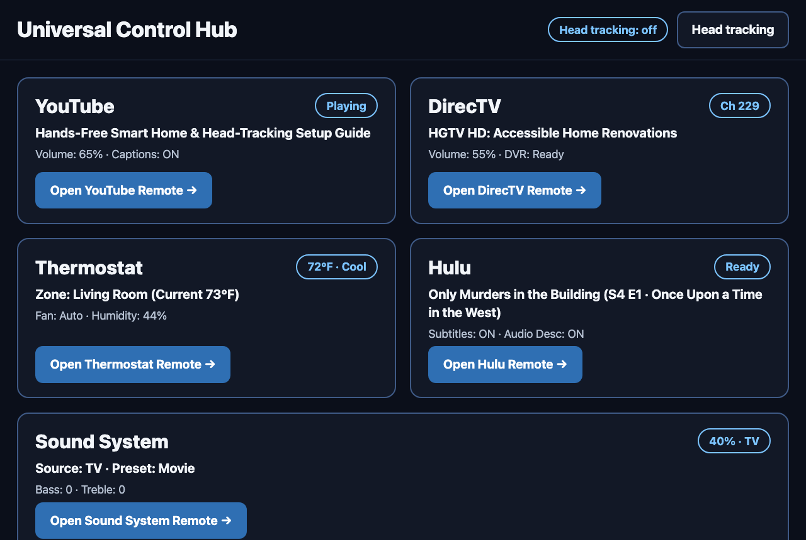
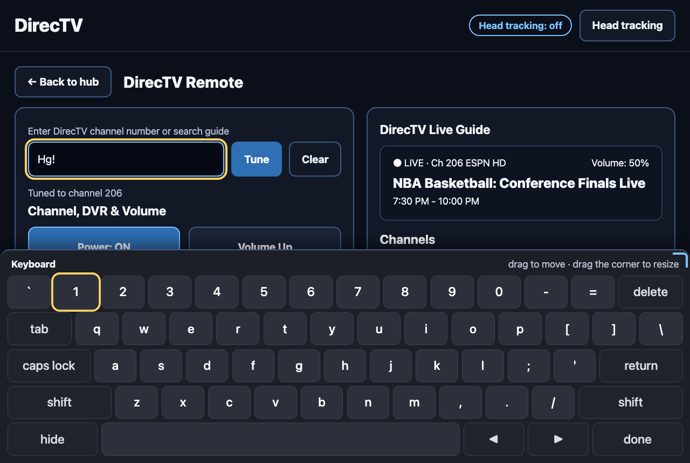
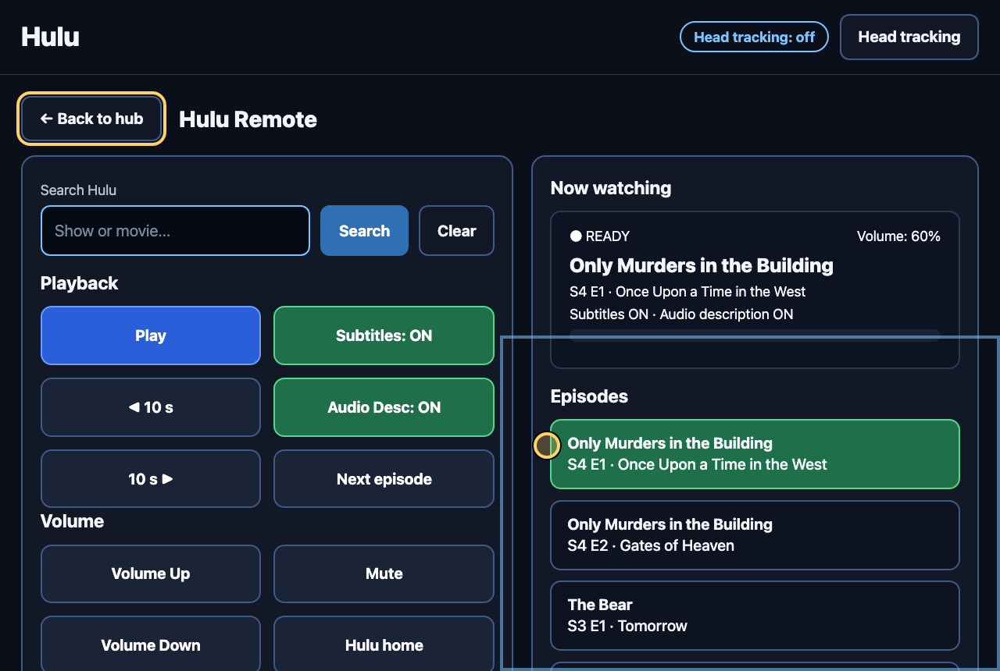

# Universal Control Hub: remote control through head tracking

One screen for the remotes a person would otherwise hold in their hands:
YouTube, DirecTV, a thermostat, Hulu and a sound system. It is made for
someone who cannot use their hands and steers a cursor with their head, and
who needs large text. A demo app for the
[AI for Accessibility Toolkit](https://github.com/AI-for-Accessibility-Collective/AI-for-Accessibility-Toolkit).

> This is a research prototype, pre-alpha. It is a probe of what such a hub
> could be, not a replacement for assistive technology. The remotes are
> simulated: nothing here talks to a real television, thermostat or speaker.
> The head tracking is simple colour tracking of a sticker, and it needs
> good light. Do not rely on it for anything that matters.

**Try it:** [anoopsinha.github.io/ai4a11y-head-control](https://anoopsinha.github.io/ai4a11y-head-control/).
The camera picture never leaves your browser.



## How it works

**Two levels.** The hub shows a panel for each remote in the corners of the
screen. Open one and that remote fills the screen: its buttons on the left,
what it is doing on the right (the live guide, now playing, the zones).
**Back to hub** at the top left, or Escape, returns to the hub.

**Head tracking.** Put a bright sticker on your forehead. Open **Head
tracking** at the top right, turn the camera on, select the sticker in the
picture so the tracker learns its colour, hold your head still and choose
**Center**. From then on the cursor follows your head. The screen is divided
into four regions, the corners, and the one the cursor is in lights up, so a
small movement is enough to reach a group of controls. Sensitivity,
smoothing, colour tolerance and mirroring are sliders.

**Selecting with one switch.** Press the select key (Space by default, or
Enter, or any key) and the hub presses whatever the cursor is on. A switch
wired as a key works the same. **Dwell** is an option: hold still on a
control for a moment and it is pressed; a ring shows the wait.

**The keyboard.** It appears only when a text box is selected (the channel
or search box), rising from the bottom and shrinking the screen above it,
in the shape of Apple's on-screen keyboard: the number row, three letter
rows, shift and caps lock, delete, return, space and arrows. Drag anywhere
that is not a key to move it; it then floats over the screen. Drag the
corner grip to make it bigger or smaller. **done** or **return** sends the
text; **hide** puts it away; double-click its bar to dock it again.



**Layout.** Up is always above down, in the same column: Channel Up over
Channel Down, Volume Up over Volume Down, Warmer over Cooler, Bass + over
Bass −. Every button is at least 56 pixels tall; no text is smaller than
18 pixels (about 13.5 points).



## Run it

```bash
npm start     # http://127.0.0.1:5176/  (Node 20 or later, nothing to install)
npm test      # a syntax check of every file
```

The camera needs a secure page: `localhost` and the GitHub Pages copy both
count.

## What is in it

```
public/index.html     the page: hub, remote, keyboard, settings, regions, cursor
public/style.css      dark, high contrast, big targets
public/js/apps.js     the five remotes: state, panel text, controls, information
public/js/app.js      rendering, one click handler, wiring
public/js/keyboard.js the on-screen keyboard
public/js/cursor.js   the head cursor: regions, select key, dwell
public/js/head.js     camera and sticker tracking
server.js             a zero-dependency static server
```

## Known limits

- **Colour tracking** needs the sticker to be the brightest thing of its
  colour in view. Strong backlight, a same-coloured shirt or a dim room
  confuse it. Pick a colour that is not in the background.
- **Calibration** is a centre point and a sensitivity, nothing more. If the
  camera or chair moves, choose Center again.
- **Nothing is controlled.** Every remote is a simulation of the kind of
  state a device has, so the interface can be tried without the devices.
- **The toolkit is not connected yet.** The person's profile (text size,
  dwell time, select key) is a natural next step.

## License

Licensed under [Apache 2.0](LICENSE), like the toolkit. Contributions follow
the [code of conduct](CODE_OF_CONDUCT.md).
